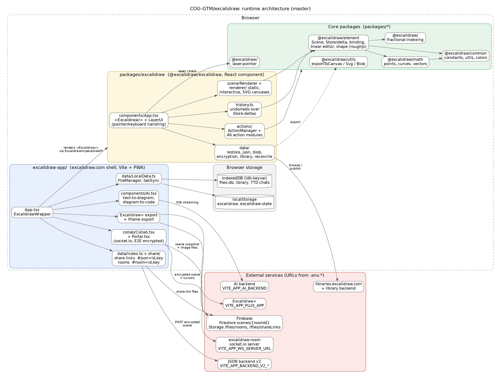

# Architecture

This page describes what the code on `master` does today. It covers the monorepo layout, how the editor library and the excalidraw.com app fit together, and which outside services the app talks to.

The diagram source is [`diagrams/architecture.dot`](./diagrams/architecture.dot) (Graphviz). After editing it, run `docs/diagrams/render.sh` to regenerate `architecture.png` and `architecture.svg`.

## Repository layout

| Path | Package | What it is |
| --- | --- | --- |
| `packages/excalidraw/` | `@excalidraw/excalidraw` | The React editor component published to npm. |
| `packages/element/` | `@excalidraw/element` | Element model and operations: `Scene`, `Store` and deltas, binding, linear/elbow arrows, text, frames, roughjs shapes. |
| `packages/math/` | `@excalidraw/math` | Geometry primitives (points, vectors, curves, polygons). |
| `packages/common/` | `@excalidraw/common` | Shared constants, colors, keys, event emitters and utilities. |
| `packages/utils/` | `@excalidraw/utils` | Headless export helpers (`exportToCanvas`, `exportToSvg`, `exportToBlob`). |
| `packages/fractional-indexing/` | `@excalidraw/fractional-indexing` | Fractional indices that order elements for multiplayer reconciliation. |
| `packages/laser-pointer/` | `@excalidraw/laser-pointer` | Stroke smoothing for the laser pointer and other animated trails. |
| `excalidraw-app/` | `excalidraw-app` (private) | The excalidraw.com web app: a shell around the editor that adds collaboration, sharing, local persistence, AI and Excalidraw+ features. |
| `examples/` |  | Integration examples (`with-nextjs`, `with-script-in-browser`). |
| `dev-docs/` |  | Docusaurus source for docs.excalidraw.com. |
| `firebase-project/` |  | Firestore and Storage rules used by the app's Firebase project. |
| `scripts/` |  | esbuild package builds, release, locale coverage and font (woff2/wasm) tooling. |

Package dependencies (from each `package.json`):

- `common` has no internal dependencies; `math` depends on `common`.
- `element` depends on `common`, `math` and `fractional-indexing`.
- `utils` depends on `laser-pointer`.
- `excalidraw` depends on `common`, `element`, `math` and `laser-pointer`, and imports its export functions from `utils` (`@excalidraw/utils/export`).
- `excalidraw-app` imports the packages through Vite path aliases (`excalidraw-app/vite.config.mts`), so it always runs against the source in `packages/`, not published builds. Vitest uses the same aliases (`vitest.config.mts`).

## The editor library (`packages/excalidraw`)

- **Entry point.** `index.tsx` exports the `<Excalidraw />` component plus the public API (restore, export, serialization, UI slots such as `MainMenu` and `WelcomeScreen`). Hosts drive the editor through `ExcalidrawImperativeAPI`.
- **`components/App.tsx`.** The central class component. It owns `AppState`, handles pointer, keyboard, clipboard and drop events, and renders `LayerUI` (toolbars, menus, dialogs, sidebar) on top of the canvases.
- **Actions (`actions/`).** Each user operation (align, flip, delete, change stroke, export, ...) is an action registered with `ActionManager`. Actions feed the toolbar, context menu, command palette and keyboard shortcuts.
- **Rendering (`scene/`, `renderer/`).** `scene/Renderer` decides which elements are visible. `renderer/staticScene` draws elements on the static canvas, `renderer/interactiveScene` draws selection, handles and remote cursors on a second canvas, and `staticSvgScene` drives SVG export. Shapes come from roughjs and are cached per element in `@excalidraw/element`.
- **State and history.** Elements live in the `Scene` from `@excalidraw/element`. `Store` turns each change into a delta, and `history.ts` implements undo/redo on top of those deltas. Jotai atoms (`editor-jotai.ts`) hold UI state outside React props.
- **Data (`data/`).** `restore.ts` normalizes elements and app state loaded from files, links or storage; `json.ts`/`blob.ts` read and write `.excalidraw` files and PNGs with embedded scenes; `encryption.ts` provides the AES-GCM helpers used by sharing and collaboration; `reconcile.ts` merges remote element versions; `library.ts` manages shape libraries.
- **Other features.** i18n (`i18n.ts`, `locales/`), fonts (`fonts/`), lasso and eraser tools, snapping, Mermaid import (`mermaid.ts`, via `@excalidraw/mermaid-to-excalidraw`) and the text-to-diagram dialog (`components/TTDDialog`).

## The web app (`excalidraw-app`)

`index.tsx` mounts `App.tsx`, which wraps `<Excalidraw />` and adds:

- **Local persistence.** `data/LocalData.ts` debounces saves of elements and app state to `localStorage` (`excalidraw`, `excalidraw-state`) and stores image files, the library and text-to-diagram chats in IndexedDB through `idb-keyval`. `data/tabSync.ts` keeps multiple tabs in step.
- **Share links.** `data/index.ts` encrypts the scene in the browser, POSTs it to the JSON backend (`VITE_APP_BACKEND_V2_POST_URL`) and builds a `#json=<id>,<key>` link. The key stays in the URL fragment and never reaches the server. Images for share links go to Firebase Storage (`/files/shareLinks`).
- **Live collaboration.** `collab/Collab.tsx` and `collab/Portal.tsx` connect to the excalidraw-room socket.io server (`VITE_APP_WS_SERVER_URL`) for a `#room=<id>,<key>` link. Scene updates, cursors and idle status are encrypted with the room key before they are sent. The latest scene is also saved to Firestore (`scenes/<roomId>`) and images to Firebase Storage (`/files/rooms`) so late joiners can load the room.
- **AI.** `components/AI.tsx` streams text-to-diagram (`/v1/ai/text-to-diagram/chat-streaming`) and diagram-to-code (`/v1/ai/diagram-to-code/generate-streaming`) responses from `VITE_APP_AI_BACKEND` as server-sent events.
- **Excalidraw+.** Export to Excalidraw+ (uploads via Firebase), the iframe export bridge (`ExcalidrawPlusIframeExport.tsx`), promo banner and sidebar.
- **App shell.** Main menu, welcome screen, footer, language detection, theme handling, Sentry error reporting (`sentry.ts`) and the PWA service worker (`vite-plugin-pwa`).

Service URLs come from `.env.development` and `.env.production` at the repo root (`envDir: "../"` in the Vite config). The development file points the collab server at `http://localhost:3002` and the AI backend at `http://localhost:3016`, so those features need local servers when you run the app in development mode.

## Build, test and deploy

- **App.** `yarn start` runs Vite in `excalidraw-app`, on port 3001 by default (`VITE_APP_PORT` in `.env.development`). `yarn build` writes `excalidraw-app/build`, with Rollup `manualChunks` splitting locales and heavy dependencies into separate chunks.
- **Packages.** `yarn build:packages` builds each package except `@excalidraw/utils` to `dist/` with esbuild (`scripts/buildBase.js`, `scripts/buildPackage.js`) and emits type declarations. `@excalidraw/utils` has its own `build:esm` script (`scripts/buildUtils.js`) that the root script does not call.
- **Checks.** `yarn test:typecheck` (tsc), `yarn test:code` (ESLint), `yarn test:other` (Prettier) and `yarn test:app` (Vitest with jsdom and `vitest-canvas-mock`). `.github/workflows/` runs these on Node 20.
- **Deploy targets.** `vercel.json` serves `excalidraw-app/build`. The `Dockerfile` builds the app with `yarn build:app:docker` (Sentry disabled) and serves the static files from nginx on port 80; `docker-compose.yml` maps that to port 3000.

## Who wrote this code

COG-GTM/excalidraw is a fork of [excalidraw/excalidraw](https://github.com/excalidraw/excalidraw), and every commit on `master` comes from upstream. By non-merge commit count across the whole history, the main authors are David Luzar (855), Aakansha Doshi (505), Lipis (272), Christopher Chedeau (141) and Márk Tolmács (124). Since 2025 most commits come from David Luzar, Márk Tolmács, Marcel Mraz, Ryan Di and zsviczian, who also lead the per-package history of `packages/excalidraw`, `packages/element`, `packages/common` and `excalidraw-app`.
